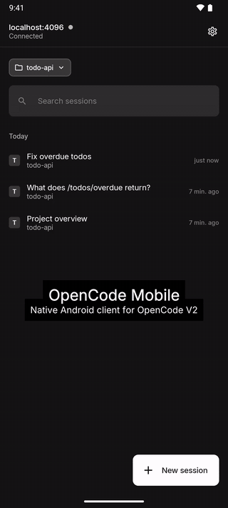

# OpenCode Mobile

**An unofficial native Android client for [OpenCode](https://opencode.ai).** Follow your
coding sessions live from your phone, send prompts, approve permissions and answer the
agent's questions while you are away from the desk.

[](../../actions/workflows/ci.yml)


[](LICENSE)

<p align="center">
  
  <br>
  <sub>Real OpenCode server, sped up 1.5×. <a href="docs/media/demo.mp4">Full-speed video</a>.</sub>
</p>

<p>
  
  
  
  
</p>

> OpenCode Mobile is a community project, not affiliated with or endorsed by the OpenCode team.

## Features

- **Live transcripts**: text, reasoning and tool calls stream in as the agent works, with
  diffs, shell output and subagent sessions one tap away.
- **Drive the agent**: send prompts (steer or queue while it runs), `/` commands, `@` file
  mentions and image attachments; stop, undo and redo, compact the context, fork a session
  from any prompt.
- **Approve from the phone**: permission requests and the agent's questions show up in
  the chat.
- **Notifications**: while sessions run, the app stays connected in the background and tells
  you when one needs an answer or finishes. Allow or reject an edit right from the
  notification. The app explains them and asks for permission after you connect; turn them
  off anytime in Settings.
- **Switch agent, model and reasoning level** per session, with recently used models first.
- **Fast on large sessions**: transcripts are cached on the device and synced incrementally.
- **Swipe between chats**, reading position remembered per chat, drafts saved per session.
- **Multiple servers**, found automatically on your Wi-Fi or paired with a QR code or a
  password.
- Faithful to the OpenCode V2 look (Inter and IBM Plex Mono), light and dark theme, phones,
  foldables and tablets. Available in English, Italian, Spanish, French, German, Brazilian
  Portuguese, Russian, Simplified Chinese, Japanese, Korean and Arabic.

## Requirements

- Android 8.0 or newer.
- An [OpenCode](https://opencode.ai) **2.x** server (`opencode serve` or the background
  service) that the phone can reach: same Wi‑Fi, or a VPN such as WireGuard or Tailscale.

## Install

Download the APK from the [latest release](../../releases/latest) and open it on your phone
(allow installing from your browser or file manager when asked). The release page lists the
SHA-256 checksum of every APK.

## Connect to your server

1. On the computer running OpenCode, run:

   ```bash
   opencode pair
   ```

   It prints one-time links and a QR code with every address of the computer; the app uses
   the first one it can reach. To pin one (for example a VPN IP), add
   `--url http://<address>:4096`.
2. In the app, tap **Scan QR code** and scan it, or paste a link. You can also type the
   server URL with the server password.

On the same Wi-Fi the app also looks for OpenCode on the default port 4096 by itself: servers
it finds appear under **Found on this network**, and you only need to enter a pairing code
or the password.

Pairing codes work once and expire after a few minutes. The app keeps a token, encrypted on
the device.

> **Security:** OpenCode serves plain HTTP, so use a network you trust and never expose the
> server port to the internet. See [SECURITY.md](SECURITY.md).

## Build from source

Requirements: JDK 21 and the Android SDK (compile SDK 36).

```bash
git clone <this repository>
cd opencode-mobile/android
./gradlew :app:installDebug                    # needs a connected device or emulator
./gradlew :app:installDebug -PfakeData=true    # runs on sample data, no server needed
```

On an emulator the app finds the host's server at `http://10.0.2.2:4096` by itself; pair it
with a code from `opencode pair`.

Release builds read the signing key from `android/keystore.properties` or `OCM_KEYSTORE_*`
environment variables (see [`android/app/build.gradle.kts`](android/app/build.gradle.kts)).

## How it works

- Multi-module app: Kotlin, Jetpack Compose, Material 3, MVI, Koin, Retrofit, Room.
- The OpenCode HTTP client in `android/core/api` is **generated** from the server's OpenAPI
  document (`api/openapi.json`) and event schemas, so it follows the server contract exactly
  (`bun run generate` in `tools/api-gen`).
- Live updates come from the server's event stream (SSE); transcripts are cached in Room.

Architecture, conventions and the design system are documented in [`AGENTS.md`](AGENTS.md),
[`android/AGENTS.md`](android/AGENTS.md) and [`docs/design-system.md`](docs/design-system.md).

## Roadmap

Planned work lives in [issues labeled `feature`](../../issues?q=is%3Aissue+is%3Aopen+label%3Afeature).
Highlights:

- Session diff and changed files.
- `!` shell commands and management of queued prompts.
- A terminal through the server's PTY.

Issues labeled [`good first issue`](../../issues?q=is%3Aissue+is%3Aopen+label%3A%22good+first+issue%22)
are a good place to start.

## Contributing

Issues and pull requests are welcome. Please read [CONTRIBUTING.md](CONTRIBUTING.md) first:
pull request titles follow Conventional Commits, and issues use the templates.

## License

[MIT](LICENSE). The bundled Inter and IBM Plex Mono fonts are under the SIL Open Font
License (see [NOTICE](NOTICE)).
