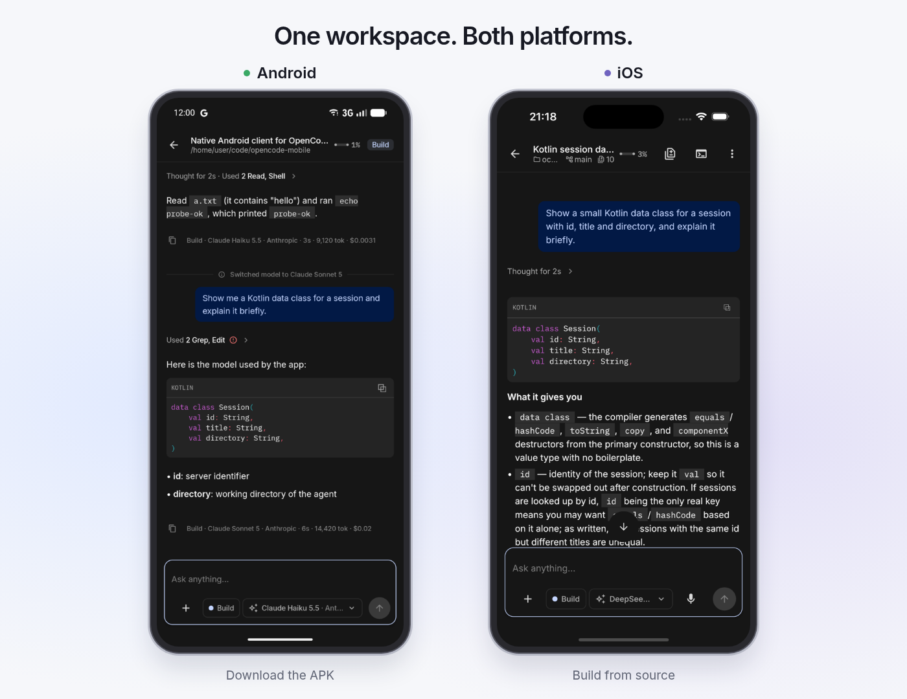
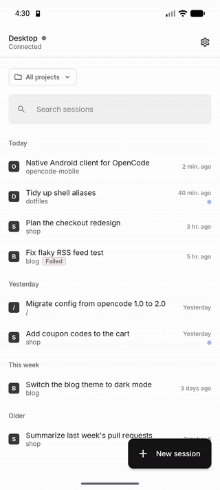
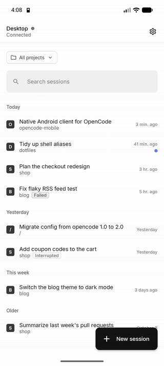

<p align="center">
  
</p>

<h1 align="center">OpenCode Mobile</h1>

<p align="center">
  <strong>Step away from your desk. Stay with your agent.</strong><br>
  A native Android and iOS client for <a href="https://opencode.ai">OpenCode</a>.<br>
  Follow live sessions, send prompts, review changes and approve the next step from your phone.
</p>

<p align="center">
  <a href="https://github.com/beppe2880/opencode-mobile/releases/latest"></a>
  <a href="#get-the-app"></a>
  <a href="#get-the-app"></a>
  <a href="https://github.com/beppe2880/opencode-mobile/actions/workflows/ci.yml"></a>
  <a href="LICENSE"></a>
</p>

<p align="center">
  <a href="https://github.com/beppe2880/opencode-mobile/releases/latest"><strong>Download Android APK</strong></a>
  &nbsp; · &nbsp;
  <a href="#ios"><strong>Build for iOS</strong></a>
  &nbsp; · &nbsp;
  <a href="#connect-in-two-steps"><strong>Quick start</strong></a>
</p>

<p align="center">
  
</p>

<p align="center">
  Android APK available now · iOS available from source<br>
  <sub>Independent community project. Not affiliated with or endorsed by the OpenCode team.</sub>
</p>

<p align="center">
  <a href="#see-it-in-action">Demo</a> ·
  <a href="#what-you-can-do">Features</a> ·
  <a href="#get-the-app">Install</a> ·
  <a href="#build-from-source">Build</a> ·
  <a href="https://github.com/beppe2880/opencode-mobile/issues">Feedback</a>
</p>

## Your workspace, within reach

| Follow the work | Keep it moving | Check the result |
| --- | --- | --- |
| Read streaming responses, reasoning, tool output and subagent conversations. | Send a prompt, answer a question or approve a permission without returning to your desk. | Review file diffs, open source files and use the server's terminal from the same app. |

Your projects and agents run on **your OpenCode server**. The app connects to your existing
sessions, so you can pick up a conversation on your phone while the work stays on your computer.

## See it in action

<table>
  <tr>
    <th>Follow a run and approve the next step</th>
    <th>Track usage and make it yours</th>
  </tr>
  <tr>
    <td align="center"></td>
    <td align="center"></td>
  </tr>
</table>

*Recorded on Android with sample data. The opening image shows Android and iOS app captures.*

<details>
<summary><strong>More screenshots: sessions, light theme and model selection</strong></summary>

<p>
  
  
  
</p>

Screenshots and recordings may show earlier versions of the app.

</details>

## What you can do

### Chat and steer

- **Live conversations** with streamed text, reasoning, tool calls, shell output and subagent sessions.
- **More than a message box:** image attachments, `@` file mentions, `/` commands and `!` shell commands.
- **Stay in control:** steer an active run or queue a prompt; send queued prompts now, edit or remove them.
- **Answer from your phone:** approve or reject permission requests and respond to the agent's questions.
- **Choose how the agent works:** switch agent, model and reasoning level per session, with recent models first.
- **Voice input:** dictate with your phone's speech recognition or a configured cloud transcription provider.

### Review and work

- **Inspect changes** for a whole session or just the last turn, with file diffs one tap away.
- **Read files** with syntax highlighting, line numbers and image previews.
- **Open a terminal** in the session's directory on the server, with a configurable key bar for Esc, Ctrl and arrows.
- **Manage context:** stop, undo, redo, compact or fork a session from a prompt.
- **Manage MCP connections** for the current project.

### Pick up where you left off

- **Cached transcripts** and incremental sync for large conversations.
- **Swipe right for the chat list** (or between chats), with saved drafts and remembered reading positions.
- **Multiple saved servers**, QR pairing and discovery on your Wi-Fi network.
- **Usage statistics** by day and model: cost, tokens and activity over 1, 7 or 30 days.
- **Home screen widgets** for running and recent sessions.
- **Light and dark themes**, optionally in the colors of an OpenCode terminal theme (markdown
  included), phone and larger-screen layouts, and the familiar OpenCode typography.

Available in **11 languages**: English, Italian, Spanish, French, German, Brazilian Portuguese,
Russian, Simplified Chinese, Japanese, Korean and Arabic.

### Platform-specific extras

| Feature | Android | iOS |
| --- | --- | --- |
| Live chat, permissions, diffs, files and terminal | Yes | Yes |
| Voice input, usage statistics and home screen widget | Yes | Yes |
| Background session notifications and permission replies from notifications | Yes | — |
| Start a session from another app's share menu | Yes | — |
| Offline demo with sample sessions | Yes | — |
| Installation | Release APK | Build from source |

On Android, choose which notifications you receive: permission requests, questions and finished
sessions. On iOS, live updates resume when you return to the app.

## Get the app

| Android | iPhone / iPad |
| --- | --- |
| **Android 8.0+** | **iOS 15+** |
| [Download the latest APK](https://github.com/beppe2880/opencode-mobile/releases/latest) | [Build the iOS app from source](#ios) |
| Open the APK on your phone and allow installation from your browser or file manager when prompted. Release assets include SHA-256 checksums. | Requires a Mac with Xcode. The iOS app is not currently distributed through the App Store or TestFlight. |

You also need an **[OpenCode 2.x](https://opencode.ai) server** that your phone can reach,
on the same Wi-Fi or through a VPN such as WireGuard or Tailscale.

**Just looking around?** On Android, tap **Try without a server** on the initial connection
screen to explore sample sessions and scripted replies. **Exit demo** returns to your real
servers; demo changes are discarded.

## Connect in two steps

**1. Get a pairing code on your computer**

With OpenCode running, use:

```bash
opencode pair
```

It prints one-time links and a QR code with your computer's addresses. To select a specific
address, such as a VPN IP, use `opencode pair --url http://<address>:4096`.

**2. Scan it on your phone**

Tap **Scan QR code**, or paste the pairing link. The app tries the addresses in the code and
saves the one it can reach. You can also enter a server URL and password manually.

On the same Wi-Fi, nearby servers appear under **Found on this network**. Select one and enter
a pairing code or password. Pairing codes are single-use and expire after a few minutes;
credentials are stored securely on the device.

> OpenCode serves plain HTTP. Use a trusted network or VPN and never expose the server port
> to the internet. See [SECURITY.md](SECURITY.md).

## Build from source

```bash
git clone https://github.com/beppe2880/opencode-mobile.git
cd opencode-mobile
```

### Android

Requirements: JDK 21 and the Android SDK (compile SDK 37).

```bash
cd android
./gradlew :app:installDebug                  # connected device or emulator
./gradlew :app:installDebug -PfakeData=true  # open the offline demo on launch
```

The Android emulator discovers the host server at `http://10.0.2.2:4096`; pair with a code
from `opencode pair`. Release signing is configured through `android/keystore.properties`
or `OCM_KEYSTORE_*` environment variables; see
[`android/app/build.gradle.kts`](android/app/build.gradle.kts).

### iOS

Requirements: macOS, Xcode and JDK 21. Set `JAVA_HOME` to your JDK installation.

1. Open [`iosApp/iosApp.xcodeproj`](iosApp/iosApp.xcodeproj) in Xcode.
2. Select an Apple Silicon iOS simulator and run the `iosApp` target. Xcode builds the shared
   Kotlin framework automatically.
3. For a physical device, configure `TEAM_ID` in
   [`iosApp/Configuration/Config.xcconfig`](iosApp/Configuration/Config.xcconfig) and enable
   the configured App Group for the app and widget.

See [Contributing](CONTRIBUTING.md#build-and-run) and the
[iOS build notes](android/AGENTS.md#ios) for command-line builds and signing details.

## Under the hood

**Kotlin Multiplatform · Compose Multiplatform · Material 3 · MVI · Koin · Ktor · Room**

Android and iOS share the UI and core logic. The thin iOS host lives in `iosApp/`; the shared
Gradle modules live in `android/`. Platform integrations handle credentials, voice input,
widgets and other OS services.

The OpenCode HTTP client is **generated from the server's OpenAPI contract** and event
schemas. Live updates arrive through SSE; transcripts are cached locally in Room.

[Architecture](AGENTS.md) · [Module guide](android/AGENTS.md) ·
[Design system](docs/design-system.md) · [API generation](tools/api-gen)

## Feedback and contributions

Found a bug or have an idea? [Open an issue](https://github.com/beppe2880/opencode-mobile/issues).
Planned work lives in [feature issues](https://github.com/beppe2880/opencode-mobile/issues?q=is%3Aissue+is%3Aopen+label%3Afeature);
[`good first issue`](https://github.com/beppe2880/opencode-mobile/issues?q=is%3Aissue+is%3Aopen+label%3A%22good+first+issue%22)
is a good place to start contributing.

Pull requests are welcome. Read [CONTRIBUTING.md](CONTRIBUTING.md) for setup, verification
and Conventional Commit titles.

## License

[MIT](LICENSE). Inter and IBM Plex Mono are licensed under the SIL Open Font License;
see [NOTICE](NOTICE).
